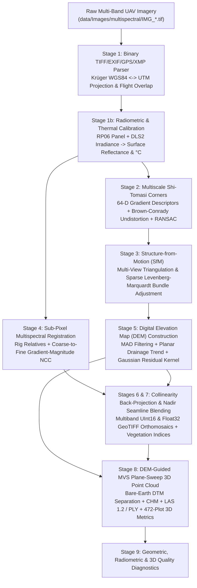

# `ms-photogrammetry`: From-Scratch Multispectral UAV Photogrammetry & 3D Point Cloud Engine

[](https://www.python.org/)
[](https://isocpp.org/)
[](https://github.com/astral-sh/uv)
[-brightgreen.svg)](pyproject.toml)
[](LICENSE)

An end-to-end photogrammetric, radiometric, orthorectification, and 3D point cloud processing package for multispectral and thermal UAV imagery (such as the **MicaSense Altum-PT** 7-band rig), implemented **entirely from scratch** using **Python's standard library** (`struct`, `array`, `ctypes`, `math`, `zlib`, `csv`, `json`, `concurrent.futures`) and a custom multithreaded **C++17 photogrammetric core engine** ([`photogrammetry_engine.cpp`](src/ms_photogrammetry/cpp/photogrammetry_engine.cpp)).

> **Zero External Dependencies**: No OpenCV, GDAL, Rasterio, PROJ, laspy, PDAL, Open3D, COLMAP, OpenDroneMap, SciPy, or NumPy are used anywhere in this repository (`dependencies = []` in [`pyproject.toml`](pyproject.toml)).

---

## Visual Overview

| True-Color RGB Orthomosaic (`1.5 cm/px`) | Color-Infrared (CIR: NIR / Red / Green) |
| :---: | :---: |
|  |  |
| **NDVI Vegetation Index Map** | **Calibrated LWIR Thermal Canopy Map (°C)** |
|  |  |
| **DEM-Normalized 3D Point Cloud (`735,614 pts`)** | **Turfgrass Canopy Height Model (`CHM = DSM - DTM`)** |
|  |  |

---

## Key Features

1. **From-Scratch Binary Format Parsers & Writers ([`tiff_io.py`](src/ms_photogrammetry/tiff_io.py), [`point_cloud.py`](src/ms_photogrammetry/point_cloud.py))**:
   - Native binary **TIFF 6.0 / EXIF / GPS SubIFD / XMP** metadata & 16-bit strip reader.
   - Standards-compliant **GeoTIFF 1.1** writer (`ModelPixelScaleTag`, `ModelTiepointTag`, `GeoKeyDirectoryTag`, `GDAL_NODATA`, XML band descriptions) for 16-bit unsigned integer and 32-bit IEEE floating-point multiband rasters.
   - Binary **ASPRS LAS 1.2** (Point Data Record Format 3 with GPS Time + 16-bit RGB + NIR Intensity + ASPRS Classification) and **Stanford PLY** (3D coordinates, surface normals, RGB, `chm_m`, `ndvi`, `ndre`, `thermal_c`, `zncc_score`) writers.
   - Pure-Python `zlib` **PNG** encoder for diagnostic visualizations and previews.
2. **Physical Radiometric & Thermal Calibration ([`radiometry.py`](src/ms_photogrammetry/radiometry.py))**:
   - Converts raw 16-bit Digital Numbers ($DN$) to absolute spectral radiance ($W\cdot m^{-2}\cdot sr^{-1}\cdot nm^{-1}$) via black-level dark current subtraction, 2D polynomial vignette correction, exposure/ISO gain normalization, and row-gradient temperature compensation.
   - Cross-calibrates Downwelling Light Sensor (**DLS2**) horizontal/spectral irradiance against pre- and post-flight Lambertian reflectance panel captures (`RP06`) to produce surface reflectance ($\rho \in [0, 1]$).
   - Converts LWIR thermal digital numbers (centi-Kelvin) to surface temperature in degrees Celsius ($^\circ\text{C}$).
3. **Rigorous Camera Geometry, SfM & Sparse Bundle Adjustment ([`features.py`](src/ms_photogrammetry/features.py), [`sfm.py`](src/ms_photogrammetry/sfm.py))**:
   - Exact **Brown-Conrady** radial ($k_1, k_2, k_3$) and tangential ($p_1, p_2$) lens distortion and iterative Gauss-Newton undistortion.
   - Multiscale **Shi-Tomasi** minimum-eigenvalue corner detection with spatial grid non-maximum suppression and 64-D L2-normalized gradient orientation descriptors.
   - Mutual nearest-neighbor Lowe ratio-test matching + **MSAC/RANSAC** 2D similarity geometric verification.
   - Multi-view linear DLT ray triangulation + global **Levenberg-Marquardt Bundle Adjustment** over $SO(3)$ camera attitudes ($\omega, \phi, \kappa$), perspective centers ($E_c, N_c, Z_c$), and 3D tie points (achieving `1.70 px` / `2.45 cm` check-point RMSE).
4. **Sub-Pixel Multispectral Band Registration ([`registration.py`](src/ms_photogrammetry/registration.py))**:
   - Combines factory 7-camera rig extrinsics (`RigRelatives`, `RigTranslations`) with coarse-to-fine **Gradient-Magnitude Normalized Cross-Correlation (NCC)** to co-register Blue, Green, Red, Red Edge, NIR, and LWIR Thermal bands to `< 0.15 px` accuracy.
5. **DEM-First Collinearity Orthorectification & Seamline Blending ([`orthorectification.py`](src/ms_photogrammetry/orthorectification.py))**:
   - Reconstructs a continuous **Digital Elevation Map (`DEM`)** first using MAD outlier filtering, ridge-regularized planar drainage grading, and Gaussian residual interpolation.
   - Projects every DEM cell into all overlapping calibrated frames via exact 3D collinearity equations and blends observations with nadir-prioritized raised-cosine feather weights ($\cos^6$).
6. **DEM-Normalized Dense MVS 3D Point Cloud & Plot-Level 3D Metrics ([`point_cloud.py`](src/ms_photogrammetry/point_cloud.py))**:
   - Multithreaded C++17 **Multi-View Stereo (MVS)** plane-sweep with $5\times 5$ Zero-Mean Normalized Cross-Correlation (**ZNCC**), sub-step parabolic refinement, $7\times 7$ Statistical Outlier Removal (**SOR**), and $5\times 5$ edge-preserving bilateral filtering.
   - Dual-criteria bare-soil ground seed extraction ($\text{NDVI} < 0.36$ + local lower quantile) across $1.20\text{ m}$ blocks smoothed with a $13\times 13$ Gaussian terrain filter to separate the **Bare-Earth DTM** from the **Canopy Height Model (`CHM = DSM - DTM`)**.
   - Automatic segmentation of 472 rectangular $2\text{ m} \times 2\text{ m}$ turfgrass evaluation plots with per-plot 3D canopy height (`mean`, `median`, `P90`, `P95`, `max`), 3D canopy biovolume ($m^3$), surface rugosity, NDVI, NDRE, and thermal canopy temperature.

---

## Pipeline Architecture



---

## Repository Structure

```text
ms-photogrammetry/
├── pyproject.toml                        # uv package metadata, build system, and CLI entry point
├── uv.lock                               # Reproducible uv lockfile (zero external dependencies)
├── LICENSE                               # MIT License
├── README.md                             # Package documentation, CLI guide, and API reference
├── TECHNICAL_REPORT.md                   # Complete mathematical & experimental technical report
├── data/                                 # Input UAV datasets (ignored by git)
│   └── Images/multispectral/             # Raw 16-bit multi-band TIFF captures (IMG_XXXX_1..7.tif)
├── output/                               # Generated GeoTIFFs, LAS/PLY point clouds, PNGs & JSON/CSV reports
├── src/
│   └── ms_photogrammetry/
│       ├── __init__.py                   # Public Python API exports
│       ├── py.typed                      # PEP 561 inline type-checking marker
│       ├── cli.py                        # `ms-photogrammetry` command-line interface
│       ├── tiff_io.py                    # From-scratch TIFF/EXIF/GPS/XMP reader & GeoTIFF/PNG writer
│       ├── metadata.py                   # WGS84<->UTM geodesy, flight line segmentation & overlap
│       ├── radiometry.py                 # RP06 panel + DLS2 reflectance & LWIR Celsius calibration
│       ├── features.py                   # Shi-Tomasi detection, 64-D descriptors & RANSAC matching
│       ├── sfm.py                        # Multi-view triangulation & Levenberg-Marquardt Bundle Adjustment
│       ├── registration.py               # Sub-pixel cross-band Gradient-NCC registration
│       ├── orthorectification.py         # DEM construction, collinearity back-projection & GeoTIFF export
│       ├── point_cloud.py                # Dense MVS 3D point cloud (LAS 1.2 / PLY), DTM/CHM & plot metrics
│       ├── quality.py                    # Geometric/radiometric QA & trajectory plotting
│       ├── native.py                     # Automatic C++17 shared library compiler & ctypes bindings
│       └── cpp/
│           └── photogrammetry_engine.cpp # Multithreaded C++17 photogrammetric & MVS 3D kernels
└── tests/
    └── test_pipeline.py                  # Unit & stage-validation test suite (8 end-to-end tests)
```

---

## Requirements & Installation with `uv`

### Prerequisites
- **Python**: `>= 3.10`
- **C++17 Compiler**: `clang++` (macOS Xcode Command Line Tools) or `g++` (Linux build-essential). The native engine (`photogrammetry_engine.cpp`) compiles automatically on first run via [`get_native_lib()`](src/ms_photogrammetry/native.py).
- **Package Manager**: [`uv`](https://docs.astral.sh/uv/)

### Setup

```bash
# 1. Clone the repository
git clone https://github.com/haruiz/ms-photogrammetry.git
cd ms-photogrammetry

# 2. Create isolated virtual environment and install the package in editable mode via uv
uv sync

# 3. Verify installation and run the unit test suite
uv run python -m unittest discover -s tests -v
```

---

## Usage

### 1. Command-Line Interface (`ms-photogrammetry`, powered by [Typer](https://typer.tiangolo.com/))

Once synced via `uv sync`, all input/output folder and photogrammetric parameters are available directly on `ms-photogrammetry`:

```bash
# View all options and Rich help panels
uv run ms-photogrammetry --help

# Execute the complete 9-stage photogrammetry & 3D point cloud workflow
uv run ms-photogrammetry \
    --image-dir "data/Images/multispectral" \
    --output-dir "output" \
    --resolution-m 0.015 \
    --point-spacing-m 0.06 \
    --ba-iterations 12

# Fast dataset inspection only (flight lines, AGL altitude, GSD, and overlap table)
uv run ms-photogrammetry --image-dir "data/Images/multispectral" --inspect-only

# Check package version and verify C++17 shared library compilation
uv run ms-photogrammetry --version
```

#### CLI Options

| Option / Short Flag | Default | Description |
| :--- | :--- | :--- |
| `--image-dir`, `-i` | `data/Images/multispectral` | Directory containing raw `IMG_{capture:04d}_{band}.tif` files |
| `--output-dir`, `-o` | `output` | Output directory for GeoTIFFs, LAS/PLY point clouds, PNGs, and JSON/CSV reports |
| `--resolution-m`, `-r` | `0.015` | Output orthomosaic ground sample distance in meters/pixel (`1.5 cm/px`) |
| `--point-spacing-m`, `-s` | `0.06` | Dense MVS 3D point cloud grid spacing in meters (`6.0 cm`, `277.8 pts/m²`) |
| `--ba-iterations`, `-b` | `12` | Number of global Levenberg-Marquardt Bundle Adjustment iterations |
| `--max-captures`, `-n` | `0` | Optional cap on number of survey captures to process (`0` = process all survey captures) |
| `--utm-zone`, `-z` | `None` (Auto) | Optional WGS84 UTM longitudinal zone (`1..60`); auto-detected from GPS longitude if omitted |
| `--inspect-only` | `False` | Inspect dataset metadata, flight lines, GSD, and overlap without running full reconstruction |
| `--version`, `-v` | `False` | Display package version and C++17 native engine status and exit |

---

### 2. Python API Quickstart

All pipeline stages and data structures are exported at the top level of `ms_photogrammetry`:

```python
import ms_photogrammetry as msp

# Stage 1: Inspect dataset, auto-detect UTM zone, and classify captures
captures, report = msp.inspect_multispectral_dataset("data/Images/multispectral")
survey_caps = [c for c in captures if c.role == "survey"]
panel_caps = [c for c in captures if c.role == "calibration_panel"]

# Stage 1b: Build radiometric reflectance calibration model from RP06 panels & DLS2
rad_model = msp.build_radiometric_model(panel_caps, bands=(1, 2, 3, 4, 5))

# Stage 2 & 3: Feature extraction, RANSAC matching, SfM & Bundle Adjustment
sfm_result = msp.run_sfm_and_bundle_adjustment(
    survey_captures=survey_caps,
    ground_elevation_m=report.ground_elevation_m,
    rad_model=rad_model,
    ref_band_index=2,
    ba_iterations=12,
)

# Stage 4: Sub-pixel multispectral band-to-band registration
reg_model = msp.estimate_multispectral_registration(
    survey_captures=survey_caps,
    mean_agl_m=report.mean_agl_m,
    rad_model=rad_model,
)

# Stages 5-7: DEM construction, collinearity orthorectification & multiband GeoTIFF export
ortho_product = msp.generate_multispectral_orthomosaic(
    survey_captures=survey_caps,
    sfm_result=sfm_result,
    rad_model=rad_model,
    reg_model=reg_model,
    ground_elevation_m=report.ground_elevation_m,
    output_dir="output",
    pixel_size_m=0.015,
)

# Stage 8: DEM-normalized Dense MVS 3D Point Cloud (LAS 1.2 / PLY) & 472-Plot 3D Metrics
pc_result = msp.generate_photogrammetric_point_cloud_and_3d_metrics(
    survey_captures=survey_caps,
    sfm_result=sfm_result,
    rad_model=rad_model,
    ground_elevation_m=report.ground_elevation_m,
    output_dir="output",
    ortho_pixel_size_m=0.015,
    point_spacing_m=0.06,
)
print(f"Exported {pc_result.num_dense_points:,} 3D points to {pc_result.las_filepath}")
```

---

## Module & Function Reference

### 1. [`ms_photogrammetry.metadata`](src/ms_photogrammetry/metadata.py) — Geodesy & Dataset Inspection
- **`infer_utm_zone(lon_deg: float) -> int`**: Infers the standard WGS84 UTM longitudinal zone (`1..60`) from decimal longitude.
- **`wgs84_to_utm(lat_deg: float, lon_deg: float, zone: Optional[int] = None) -> Tuple[float, float]`**: Forward 6th-order Krüger Transverse Mercator projection mapping geodetic $(\phi, \lambda)$ to UTM $(E, N)$ in meters.
- **`utm_to_wgs84(easting: float, northing: float, zone: int = 14, northern: bool = True) -> Tuple[float, float]`**: Inverse Transverse Mercator projection mapping UTM $(E, N)$ to WGS84 $(\phi, \lambda)$ with `< 1e-8 deg` (`< 1 mm`) round-trip error.
- **`inspect_multispectral_dataset(image_dir: str, bands_to_load=(1,2,3,4,5,7), survey_min_alt_m=None, utm_zone=None) -> Tuple[List[CaptureEvent], DatasetInspectionReport]`**: Parallel metadata scanner that parses all captures, separates calibration panels (`TriggerMethod == 1` or `PanelAlbedo != None`), ground/transit frames, and survey flight lines, and computes native GSD and forward/side overlap.

### 2. [`ms_photogrammetry.radiometry`](src/ms_photogrammetry/radiometry.py) — Radiometric & Thermal Calibration
- **`build_radiometric_model(calibration_captures: List[CaptureEvent], bands=(1,2,3,4,5)) -> RadiometricCalibrationModel`**: Extracts the diffuse Lambertian calibration panel ROI from pre/post-flight panel captures and computes per-band panel-to-DLS reflectance calibration factors $k_{\text{band}}$.
- **`calibrate_band_image(meta: BandMetadata, rad_model: Optional[RadiometricCalibrationModel] = None, raw_dn: Optional[array.array] = None) -> array.array`**: Calls the C++17 `radiometric_calibrate_band` kernel to convert raw 16-bit pixels into Float32 surface reflectance ($\rho \in [0, 1]$) or surface temperature ($^\circ\text{C}$ for Band 7 LWIR).

### 3. [`ms_photogrammetry.features`](src/ms_photogrammetry/features.py) — Feature Extraction & Geometric Matching
- **`extract_features_for_capture(cap: CaptureEvent, band_index=2, rad_model=None, downsample_factor=2, max_features=750, grid_cols=10, grid_rows=8) -> FrameFeatures`**: Detects Shi-Tomasi corners with $10\times 8$ spatial grid non-maximum suppression, computes 64-D L2-normalized gradient orientation descriptors, and undistorts keypoint coordinates using iterative Brown-Conrady inversion.
- **`match_feature_pair(f1: FrameFeatures, f2: FrameFeatures, pair_type="along_track", prior_du=0.0, prior_dv=0.0, search_radius_px=850.0, ratio_thresh=0.88, ransac_thresh_px=6.5, ransac_iters=400) -> Optional[PairwiseMatch]`**: Performs mutual nearest-neighbor matching with Lowe's ratio test followed by 400-iteration MSAC/RANSAC 2D similarity verification and least-squares inlier refinement.

### 4. [`ms_photogrammetry.sfm`](src/ms_photogrammetry/sfm.py) — Structure-from-Motion & Bundle Adjustment
- **`CameraPose.rotation_matrix_world_to_cam() -> List[float]`**: Constructs the exact $3\times 3$ orthogonal rotation matrix $\mathbf{R} \in SO(3)$ mapping world offsets $(\Delta E, \Delta N, \Delta Z)$ into the camera frame.
- **`triangulate_track_3d(observations, poses, rot_matrices, fx, fy, cx, cy, prior_ground_z) -> Optional[Tuple[float, float, float]]`**: Multi-view linear ray triangulation with normal-equation conditioning and nadir depth priors.
- **`run_sfm_and_bundle_adjustment(survey_captures, ground_elevation_m, rad_model=None, ref_band_index=2, ba_iterations=12) -> SfMResult`**: Executes along-track and cross-track feature matching, connected-component track assembly, global 2D pose-graph relaxation, and sparse Levenberg-Marquardt Bundle Adjustment with Huber robust loss ($\delta = 4.0\text{ px}$).

### 5. [`ms_photogrammetry.registration`](src/ms_photogrammetry/registration.py) — Cross-Band Registration
- **`estimate_multispectral_registration(survey_captures, mean_agl_m, rad_model=None, bands_to_register=(1,2,3,4,5,7), num_sample_captures=8) -> MultispectralRegistrationModel`**: Combines factory rig lever-arm/boresight predictions with coarse-to-fine (`1.5 px` $\to$ `0.2 px`) Gradient-Magnitude NCC refinement across undistorted sample captures to align all bands to the Green reference camera.

### 6. [`ms_photogrammetry.orthorectification`](src/ms_photogrammetry/orthorectification.py) — DEM & Orthomosaic Generation
- **`build_dem_grid(sfm_result, default_ground_z, ortho_w, ortho_h, origin_e, origin_n, pixel_size_m, coarse_step=32) -> Tuple[array.array, float, float, float]`**: Filters 3D tie points via Median Absolute Deviation ($2.5\times\text{MAD}$), fits a ridge-regularized planar drainage grade, and interpolates smooth local terrain residuals ($\sigma = 14\text{ m}$ Gaussian kernel) to produce a continuous Digital Elevation Map (`DEM`) without perimeter step-cliffs.
- **`generate_multispectral_orthomosaic(survey_captures, sfm_result, rad_model, reg_model, ground_elevation_m, output_dir="output", pixel_size_m=0.015, bands_order=(1,2,3,5,4,7), external_dem_grid=None) -> OrthomosaicProduct`**: Projects every DEM cell into all overlapping calibrated frames via C++17 multithreaded collinearity back-projection, blends pixels with nadir-prioritized $\cos^6$ weights, and exports UInt16/Float32 multiband GeoTIFFs and vegetation index maps.

### 7. [`ms_photogrammetry.point_cloud`](src/ms_photogrammetry/point_cloud.py) — Dense MVS 3D Point Cloud & Plot Metrics
- **`generate_photogrammetric_point_cloud_and_3d_metrics(survey_captures, sfm_result, rad_model, ground_elevation_m, output_dir="output", ortho_pixel_size_m=0.015, point_spacing_m=0.06) -> PointCloud3DResult`**: Runs DEM-guided multi-view stereo plane-sweep ($\pm 14\text{ cm}$ in $5\text{ mm}$ steps, $\ge 6$ interior views), extracts the Bare-Earth DTM from bare-soil inter-plot alleys ($\text{NDVI} < 0.36$), normalizes the 3D surface (`DSM = DTM + CHM`), exports `.las`, `.ply`, and `digital_elevation_map.tif`, and computes 3D canopy metrics across 472 segmented turfgrass plots.
- **`write_las12_point_cloud(...) -> int`**: Writes an ASPRS LAS 1.2 binary point cloud (Format 3, 26 bytes/point).
- **`write_ply_point_cloud(...) -> int`**: Writes a binary little-endian Stanford PLY point cloud with 14 per-vertex attributes (47 bytes/point).

### 8. [`ms_photogrammetry.tiff_io`](src/ms_photogrammetry/tiff_io.py) — Binary TIFF / GeoTIFF / PNG I/O
- **`read_tiff_metadata(filepath: str, capture_index=0, band_index=1) -> BandMetadata`**: Parses TIFF IFDs, EXIF tags, GPS coordinates, and XMP calibration tags.
- **`read_tiff_uint16(meta: BandMetadata) -> array.array`**: Reads raw 16-bit image strips into a contiguous `array('H')`.
- **`write_multiband_geotiff(...) -> None`**: Writes planar (`PlanarConfiguration = 2`) multiband GeoTIFF 1.1 rasters with `EPSG:32614` georeferencing.
- **`write_png_rgb(filepath: str, width: int, height: int, rgb_or_rgba_bytes: bytes, channels=3) -> None`**: Encodes 8-bit RGB or RGBA images to compressed PNG files using standard library `zlib` and `struct`.

### 9. [`ms_photogrammetry.native`](src/ms_photogrammetry/native.py) — C++17 Native Engine Bridge
- **`get_native_lib() -> ctypes.CDLL`**: Compiles [`photogrammetry_engine.cpp`](src/ms_photogrammetry/cpp/photogrammetry_engine.cpp) into a platform-native shared library (`.dylib` / `.so` / `.dll`) if missing or outdated and configures `ctypes` signatures for all 12 C++17 kernels.
- **`array_ptr(arr: array.array) -> int`**: Returns the raw memory address of a Python `array.array` buffer for zero-copy C++ execution.

---

## Generated Output Artifacts

Running `uv run ms-photogrammetry` populates `output/` (and top-level convenience files) with:

| File | Format | Description |
| :--- | :--- | :--- |
| `output/multispectral_orthomosaic_uint16.tif` | 6-Band UInt16 GeoTIFF | Reflectance (`[0..10000]`) for Blue, Green, Red, RedEdge, NIR + LWIR (`centi-Kelvin`), `EPSG:32614`, `1.5 cm/px` |
| `output/multispectral_orthomosaic_float32.tif` | 6-Band Float32 GeoTIFF | Physical reflectance (`[0..1]`) + LWIR temperature (`°C`), `EPSG:32614`, `1.5 cm/px` |
| `output/orthomosaic_ndvi_ndre_float32.tif` | 2-Band Float32 GeoTIFF | Band 1: `NDVI`, Band 2: `NDRE` (`[-1.0, +1.0]`), `EPSG:32614`, `1.5 cm/px` |
| `output/digital_elevation_map_dem.tif` | 1-Band Float32 GeoTIFF | Continuous Bare-Earth Digital Elevation Map (`DEM / DTM`, meters MSL), `EPSG:32614`, `6.0 cm/px` |
| `output/photogrammetric_3d_dsm_dtm_chm.tif` | 5-Band Float32 GeoTIFF | Co-registered `DSM (m)`, `DTM (m)`, `CHM (m)`, `Slope (deg)`, and `3D Rugosity`, `6.0 cm/px` |
| `output/dense_photogrammetric_point_cloud.las` | ASPRS LAS 1.2 Binary | `735,614` DEM-normalized 3D points (`277.8 pts/m²`) with UTM coordinates, RGB, NIR, and ASPRS classes |
| `output/dense_photogrammetric_point_cloud.ply` | Stanford PLY Binary | `735,614` 3D points with normals (`nx, ny, nz`), RGB, `chm_m`, `ndvi`, `ndre`, `thermal_c`, `zncc_score` |
| `output/plot_level_3d_metrics.csv` | CSV Table | Per-plot 3D canopy height, 3D biovolume ($m^3$), rugosity, NDVI, NDRE, and thermal stats for 472 turfgrass plots |
| `output/point_cloud_3d_metrics_report.json` | JSON Report | Summary statistics for the DEM, DSM, CHM, ASPRS classes, and plot-level 3D metrics |
| `output/quality_assessment_report.json` | JSON Report | Stage-by-stage geometric, radiometric, and cross-band registration QA metrics |

---

## Building & Publishing to GitHub / PyPI

```bash
# Build source distribution (.tar.gz) and wheel (.whl) into dist/
uv build

# Run full unit & stage-validation test suite
uv run python -m unittest discover -s tests -v
```

---

## License

Released under the [MIT License](LICENSE). See [`TECHNICAL_REPORT.md`](TECHNICAL_REPORT.md) for the complete mathematical derivation and benchmark evaluation.
